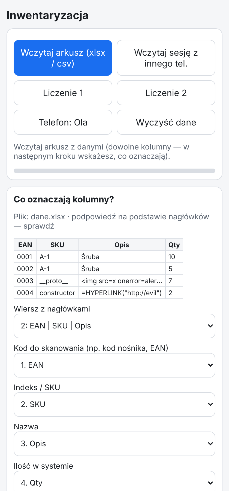
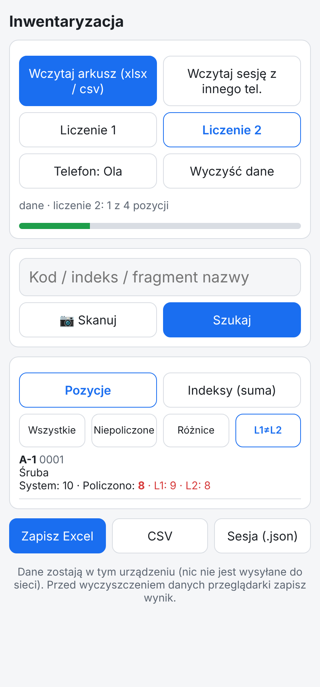

# Inwentaryzacja PWA

> **Status: prototyp (druga iteracja).** Pierwsza wersja była aplikacją Android w Capacitorze na jeden konkretny arkusz firmowy.
> Ta jest przepisana na **PWA** (instaluje się z przeglądarki, działa offline), działa na **dowolnym arkuszu** — kolumny wskazuje użytkownik —
> i nie zawiera żadnych danych firmowych. Lista braków: [Znane ograniczenia](#znane-ograniczenia).
>
> English summary at the bottom.

Mobilna inwentura magazynowa: wczytujesz arkusz z listą pozycji, skanujesz kody telefonem, zapisujesz **dwa niezależne liczenia**
i na końcu dostajesz Excel z wynikami, różnicami względem systemu i rozbieżnościami między liczeniami.

| Mapowanie kolumn | Praca |
|---|---|
|  |  |

*Zrzuty: dane testowe.*

## Co potrafi

- **Dowolny arkusz (.xlsx lub CSV)**. W kroku „Co oznaczają kolumny?” wskazujesz: kod do skanowania, indeks/SKU, nazwę, ilość w systemie
  (wystarczy kod *albo* indeks; reszta opcjonalna). Program podpowiada mapowanie po nazwach nagłówków (PL/EN) i **zapamiętuje je**
  dla tego układu kolumn. Można wybrać arkusz i wiersz nagłówków. CSV: separator wykrywany automatycznie, UTF-8 i Windows-1250.
- **Dwa niezależne liczenia**: liczenie 2 nie pokazuje wyniku liczenia 1; filtr „L1≠L2” wskazuje rozbieżności.
- **Skanowanie**: kamera (BarcodeDetector), zdjęcie kodu, a także skaner w trybie klawiatury — pole wyszukiwania akceptuje Enter.
  Szukanie po kodzie (także bez zer wiodących), indeksie albo fragmencie nazwy.
- **Suma po indeksie**: można wpisać sumę dla całego indeksu bez liczenia każdej pozycji; program porównuje ją z sumą z pozycji.
- **Kilka telefonów**: każdy telefon eksportuje plik sesji `.inwent.json`, który drugi telefon scala. Własnych wpisów scalanie
  nigdy nie nadpisuje, rozbieżności są liczone jako konflikty.
- **Eksport**: Excel (wyniki, status, różnica do systemu + arkusz sum indeksów), CSV (odporny na wstrzykiwanie formuł), sesja JSON.
- **Offline i autozapis** w IndexedDB (zapis przy każdym wpisie, odporny na zamknięcie karty). Dane nie opuszczają urządzenia.

## Uruchomienie

```bash
npm install       # pierwszy raz utworzy package-lock.json — zacommituj go (potem CI używa npm ci)
npm run build      # kopiuje bibliotekę ExcelJS do public/vendor
npm start          # http://127.0.0.1:8080
npm test           # testy jednostkowe (Node)
npm run e2e        # test w prawdziwej przeglądarce (npx playwright install chromium)
```

Wdrożenie: workflow `pages.yml` publikuje katalog `public/` na GitHub Pages (HTTPS wymagane dla PWA, kamery i instalacji).
Na telefonie: otwórz adres → menu przeglądarki → „Dodaj do ekranu głównego”. Plik testowy: `sample/przyklad.csv`.

## Bezpieczeństwo — co poprawiłem względem prototypu

- Indeks o nazwie `__proto__` (z arkusza albo z pliku z innego telefonu) **zatruwał `Object.prototype`** — słowniki to teraz `Map`-y, jest test regresji.
- Zrezygnowano z wczytywania wyników z xlsx od innych telefonów (wymiana przez walidowany JSON), a biblioteka `xlsx` 0.18.5 z publicznymi
  podatnościami została zastąpiona przez ExcelJS używany tylko do zwykłego importu i eksportu.
- Wszystkie dane trafiają do DOM przez `textContent`; CSP w `<meta>`: tylko własne skrypty i style, brak `unsafe-inline`, brak CDN.
- Limity: plik do 15 MB, 200 tys. wierszy, 200 kolumn, 500 znaków w komórce, ilości 0…1 000 000 000.

## Znane ograniczenia

- **Stare pliki `.xls` nie są obsługiwane** (zapisz jako .xlsx lub CSV).
- **Skanowanie kamerą wymaga BarcodeDetector** (Chrome/Edge na Androidzie). Safari na iPhone go nie ma — wtedy działa wpisywanie, zdjęcie nie, a skaner w trybie klawiatury działa.
- Xlsx to archiwum ZIP: limit 15 MB dotyczy pliku skompresowanego, więc specjalnie spreparowany plik („zip bomb”) może zająć dużo pamięci telefonu. Importuj pliki z zaufanych źródeł.
- Pozycje są rozpoznawane po parze *kod + indeks*; dwa identyczne wiersze (ten sam kod i indeks) są traktowane jak jedna pozycja.
- Brak synchronizacji w czasie rzeczywistym — scalanie ręczne przez pliki sesji. Brak logowania i ról (aplikacja działa lokalnie, jeden użytkownik na urządzeniu).
- Dane są w pamięci przeglądarki: jej wyczyszczenie je kasuje (aplikacja prosi o trwały magazyn, ale to przeglądarka decyduje). Zapisuj wynik na koniec dnia.
- Testy dotyczą logiki i przepływu w Chromium. Nie testowałem na prawdziwym telefonie, w Safari ani skanowania kamerą z prawdziwymi kodami.
- Biblioteka ExcelJS (4.4.0) ma duże drzewo zależności; `npm audit` uruchamia CI — przed publikacją sprawdź jego wynik.

## English summary

A mobile stocktaking PWA: load any spreadsheet (xlsx/CSV), choose which column is the scan code / SKU / name / system quantity
(mapping is remembered), scan codes, record two independent counts, merge several phones through validated JSON session files and export
Excel/CSV with differences. Works offline, keeps all data on the device. Prototype: not tested on real devices or Safari, `.xls` unsupported.
Fixes a prototype-pollution bug of the first version (`__proto__` as a SKU) and replaces a vulnerable SheetJS version.

## Licencja

MIT — zob. [LICENSE](LICENSE). Projekt nie zawiera danych żadnej firmy.
